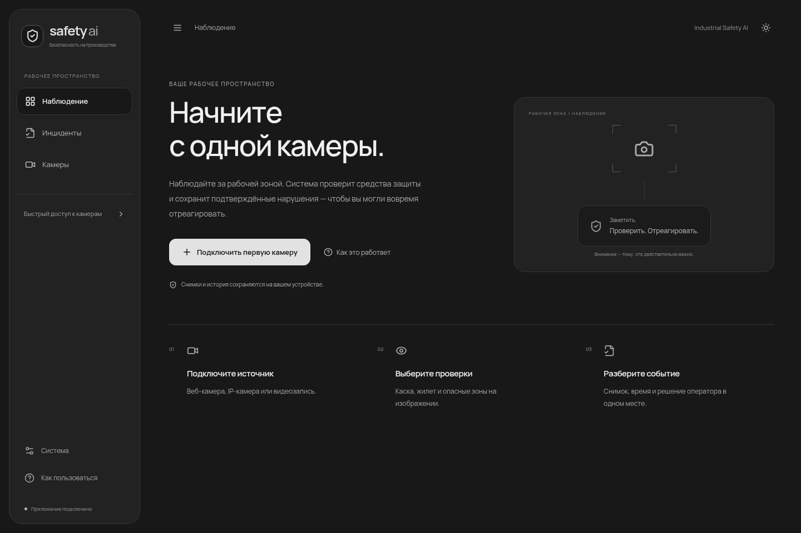
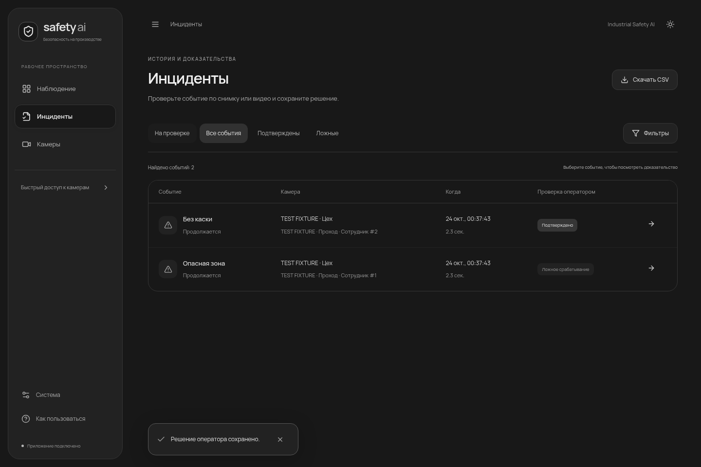
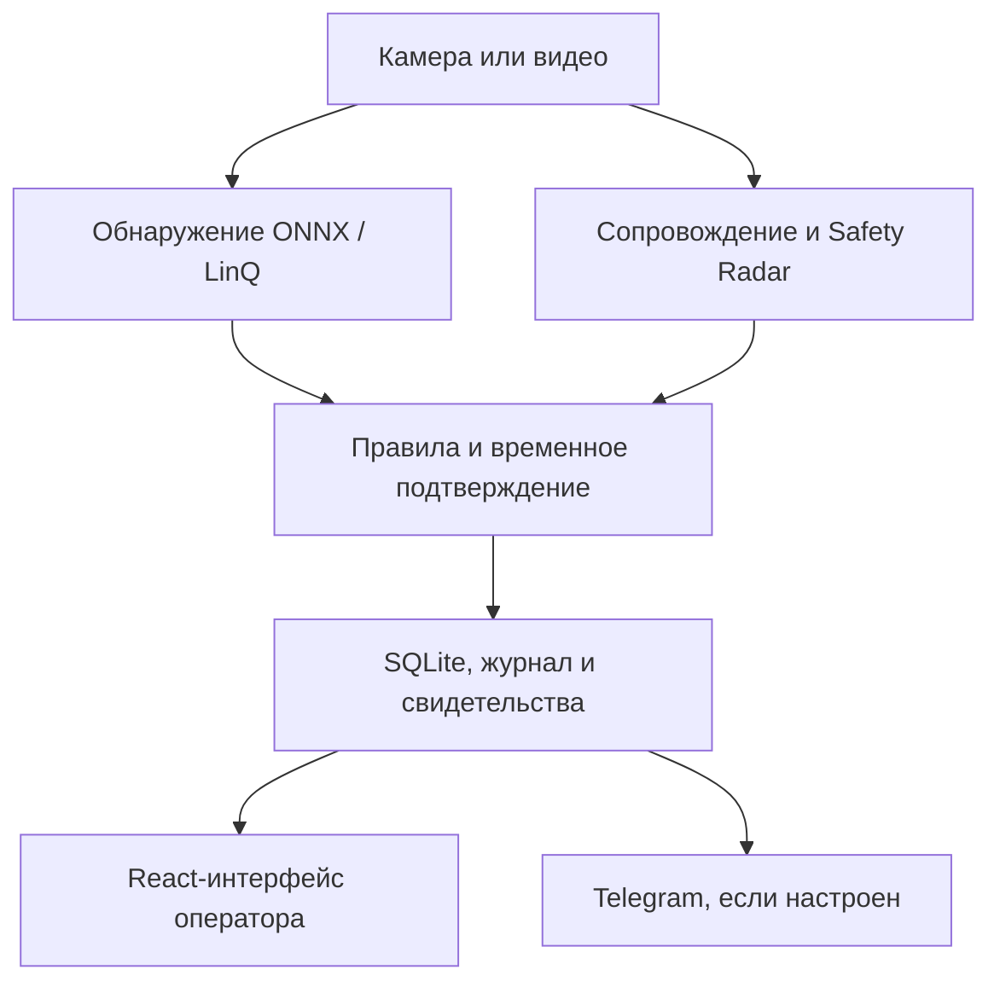

# Industrial Safety AI

Компьютерное зрение для обнаружения средств индивидуальной защиты, контроля опасных зон и работы оператора с инцидентами.

[](https://github.com/judogaaa/industrial-safety-ai-platform/actions/workflows/ci.yml)



## Возможности

- Камера браузера, видеофайл, RTSP/HTTP-поток; настройки для каждого источника.
- Обнаружение людей, касок и жилетов через ONNX Runtime; сопровождение объектов между кадрами.
- Многоугольные опасные зоны, траектории и предупреждение о приближении к границе.
- Временное подтверждение нарушений и защита от повторных инцидентов одного эпизода.
- Журнал с фильтрами, снимками, статусами и оценкой оператора; воспроизведение свидетельств и экспорт.
- Опциональные уведомления Telegram и адаптер удалённого LinQ через RabbitMQ.



Снимки показывают настоящий интерфейс. Записи журнала созданы тестовой фикстурой и не являются реальными производственными происшествиями.

## Архитектура



| Часть | Технологии |
|---|---|
| Интерфейс | React 19, TypeScript, Vite, Lucide, локальный Manrope |
| API | Python 3.11–3.12, FastAPI, Pydantic |
| Видео и модели | OpenCV, NumPy, ONNX Runtime; опциональный LinQ/RabbitMQ |
| Данные | SQLite, локальные снимки и видеосвидетельства |

PPE и анализ движения работают независимо: задержка удалённого распознавания не должна останавливать отслеживание. Устаревший ответ модели не доказывает актуальное состояние работника.

## Запуск

Нужны Python 3.11 или 3.12, Node.js 22 и FFmpeg с libx264 для видеосвидетельств (на Ubuntu: `sudo apt install ffmpeg`). Для интерфейса и API не требуется оборудование LinQ.

```bash
python -m venv .venv
# Linux/macOS: source .venv/bin/activate
# Windows PowerShell: .venv\Scripts\Activate.ps1
python -m pip install -e "backend[dev,vision,linq]" -c backend/constraints.txt
cd frontend
npm ci
npm run build
cd ..
python -m uvicorn app.main:app --app-dir backend --host 127.0.0.1 --port 8000
```

Открыть `http://127.0.0.1:8000`. Для изменения настроек скопируйте `.env.example` в `.env`.

**Распознавание требует отдельных ONNX-моделей.** Веса не входят в Git. После проверки условий правообладателей загрузите закреплённые артефакты командой `python backend/scripts/download_model.py`; загрузчик проверяет SHA-256. Альтернативный `python run.py` выполняет установку и загрузку автоматически. Для моделей Ultralytics действуют отдельные условия AGPL/коммерческой лицензии; у PPE-публикации есть противоречие между карточкой и метаданными. См. [THIRD_PARTY.md](THIRD_PARTY.md). Код без весов не распознаёт людей и СИЗ.

Для LinQ нужны разрешённый доступ, собственные параметры RabbitMQ и скомпилированная TPU-программа. Публичный адаптер реализует протокол; подключение к реальному оборудованию здесь не подтверждалось.

## Проверки

```bash
cd backend
python -m ruff check .
python -m pytest -q
cd ../frontend
npm test
npm run build
```

[Результаты проверки публичной версии](docs/VALIDATION.md) · [Архитектура](docs/ARCHITECTURE.md) · [Безопасность](SECURITY.md)

## Ограничения

Это исследовательский прототип, **не сертифицированная система промышленной безопасности**. Нет универсальной гарантии точности или FPS. Свет, перекрытия, ракурс, размер объекта и движение камеры влияют на результат. Смена track ID возможна; отсутствие детекции не означает безопасность. Режим UNKNOWN нельзя трактовать как отсутствие нарушения.

Реальная точность на вашей площадке, положительные сценарии бега и работа удалённого TPU требуют отдельной приёмки. Система не заменяет обязательный контроль безопасности и решение ответственного сотрудника.

## Условия использования

Исходники доступны для изучения и оценки по [LICENSE](LICENSE); это source-available публикация, а не предоставление свободной лицензии на весь продукт. У моделей, шрифтов и зависимостей собственные условия. Видеозаписи работников, обучающие датасеты, веса и приватные конфигурации исключены.
